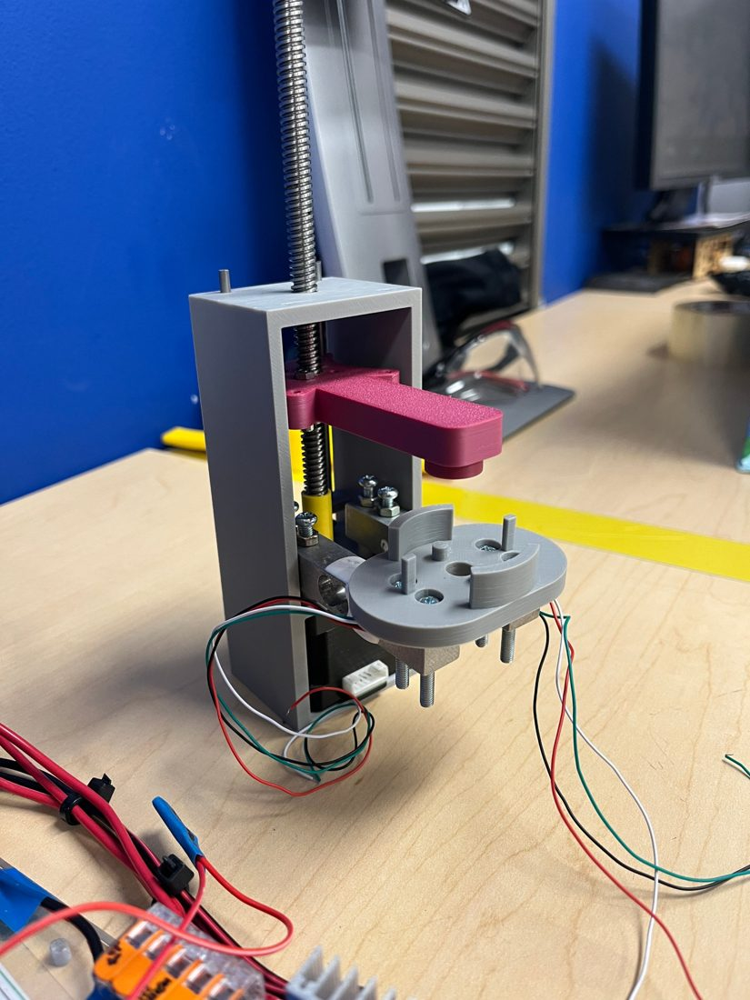

# Banco FSR · caracterización de un FSR402 dentro de silicona

Segundo banco del proyecto, **independiente del banco del dedo y con su propio ESP32**. Una prensa vertical baja un punzón con un tornillo movido por un NEMA 17 y presiona una cúpula de silicona que tiene un **FSR402** adentro. Dos **celdas de carga de 10 kg** (con un **HX711** cada una) miden la fuerza real. El ESP32 registra al mismo tiempo la posición del punzón, las dos fuerzas y el voltaje del FSR.

**▶ Página: https://luisponce15.github.io/banco-mano-robotica/fsr/**

| Pestaña | Qué tiene |
|---|---|
| **Ensayo** | Prensa animada y gráficas en vivo. Funciona con el **banco virtual** (simulación) o con el **ESP32 real por USB** (Chrome o Edge). Graba y exporta CSV. |
| **Análisis** | Curva del FSR contra la fuerza, ajuste (potencia y conductancia lineal), histéresis y repetibilidad. Abre CSV de ensayos reales. |
| **Conexiones** | Esquemático interactivo, pines, lista de cables y colores de las celdas. |
| **Montaje** | Cómo montar las celdas, la cúpula y el punzón, y la lista de chequeo antes de energizar. |
| **Modelo** | Parámetros del banco virtual y las ecuaciones que usa. |
| **Código** | Firmware, documentación y scripts de este banco. |

## Componentes

| Cant. | Componente | Uso |
|---|---|---|
| 1 | ESP32-S de **38 pines** (**otro**, no el del dedo) | Control y adquisición, alimentado por USB desde el computador |
| 1 | **Base shield** para ESP32 de 38 pines (filas G · V · S) | Conexiones con dupont; puente V en **3V3** y conector DC sin usar |
| 1 | NEMA 17 **17HS4401S** (1,7 A, 0,42 N·m) | Mueve el tornillo del punzón |
| 1 | Driver **A4988** con disipador | 1/16 de paso |
| 2 | Celda de carga tipo barra **10 kg** | Fuerza real sobre la cúpula |
| 2 | Módulo **HX711** | Amplificador y ADC de 24 bits de cada celda |
| 1 | **FSR402** dentro de la silicona | El sensor a caracterizar |
| 1 | Resistencia **10 kΩ** (o la que elijas con la simulación) | Divisor de voltaje del FSR |
| 1 | Condensador 100 nF (opcional) | Filtro en la entrada del ADC |
| 1 | Electrolítico **100 µF 25–35 V** | En VMOT del A4988 |
| 1 | Adaptador **12 V ≥ 2 A** | Potencia del motor |

## Pines del ESP32-S (sobre el shield)

Cada GPIO del shield tiene una fila **G · V · S** (tierra, 3,3 V con el puente en 3V3, señal). Mapa completo con la posición de cada pin en [`hardware/conexiones.md`](hardware/conexiones.md) y en la pestaña **Conexiones** de la página.

| GPIO | Va a |
|---|---|
| 25 / 26 / 27 | A4988 STEP / DIR / EN |
| 16 / 17 | HX711 de la celda 1: DT / SCK |
| 18 / 19 | HX711 de la celda 2: DT / SCK |
| 34 | Nodo del divisor del FSR (ADC1) |
| 3V3 / V | A4988 VDD, MS1–MS3, RST+SLP (fila 3V3) · VCC de los HX711 y FSR (pin V de su fila) |
| G | GND común: A4988 (fila 25), HX711 (filas 16 y 18), Rm (fila 34), y por el A4988 al GND de 12 V |

Detalles en [`hardware/conexiones.md`](hardware/conexiones.md), [`hardware/montaje.md`](hardware/montaje.md) y [`hardware/calibracion.md`](hardware/calibracion.md).

## Primera prueba: solo el FSR

`firmware/fsr_lectura/fsr_lectura.ino` lee solo el divisor del FSR, sin librerías. Al arrancar mide 2 s sin tocar el sensor y calcula el **umbral de detección** (el voltaje mínimo que se distingue del ruido).

- **Serial Plotter** (115200): gráfica en vivo de V, el umbral y cuándo detecta.
- Escribe `t` en el Monitor Serie para ver V, R_FSR y conductancia en texto, o `w` para verlo en la pestaña **Ensayo** de la página.
- `b` repite la línea base; `r 47000` si cambias Rm.

## Prueba de las celdas

`firmware/hx711_prueba/hx711_prueba.ino` revisa si cada HX711 responde, si la celda está saturada (hilos mal puestos) y cuánto ruido hay. Después muestra el cambio en gramos aproximados al poner peso. `p` para el Serial Plotter, `t` tara, `d` repetir el diagnóstico.

## Primera prueba: solo el motor

Se puede probar el motor antes de conectar los HX711 y el FSR: sus fuerzas quedan en 0 y el firmware avisa «SIN RESPUESTA» en la tara, lo cual es normal.

1. Motor **desconectado**: ajusta Vref ≈ 0,8 V. Apaga, conecta el motor, y conecta primero el USB y después los 12 V.
2. Página → **Ensayo** → **ESP32 por USB** → **Conectar**.
3. **Motor con fuerza (e)**: el eje del motor debe quedar duro.
4. Velocidad **1 mm/s** → **Aplicar**. Prueba con **−1** (sube) y **+1** (baja).
5. Si sube cuando debería bajar, pon `INVERT_DIR = true` en el firmware.
6. Mide cuánto se mueve el brazo con **+5** o **−5**: con varilla M8 son 5 mm (4 vueltas). Si no, corrige `LEAD_MM`.

## Flujo de un ensayo

1. Sube `firmware/fsr_ensayo/fsr_ensayo.ino` con el paquete **esp32 3.x** y la librería **FastAccelStepper** (gin66).
2. Abre la página, pestaña **Ensayo**, fuente **ESP32 por USB**, y conecta.
3. `t` tara · `c1 500` y `c2 500` calibran con una masa conocida (una sola vez; queda guardado).
4. `e` habilita el motor · `h` busca el contacto con la silicona (z = 0).
5. `r 3 0.5 2 3` corre 3 ciclos hasta 3 mm de profundidad a 0,5 mm/s con pausas de 2 s.
6. **Grabar** antes del ensayo y **Guardar CSV** al terminar. La pestaña **Análisis** saca la curva del FSR.

Sin navegador compatible: `python3 analisis/registrar_serial.py /dev/cu.usbserial-0001 ensayo.csv` guarda los datos y `python3 analisis/analizar_ensayo.py ensayo.csv` hace el análisis.
