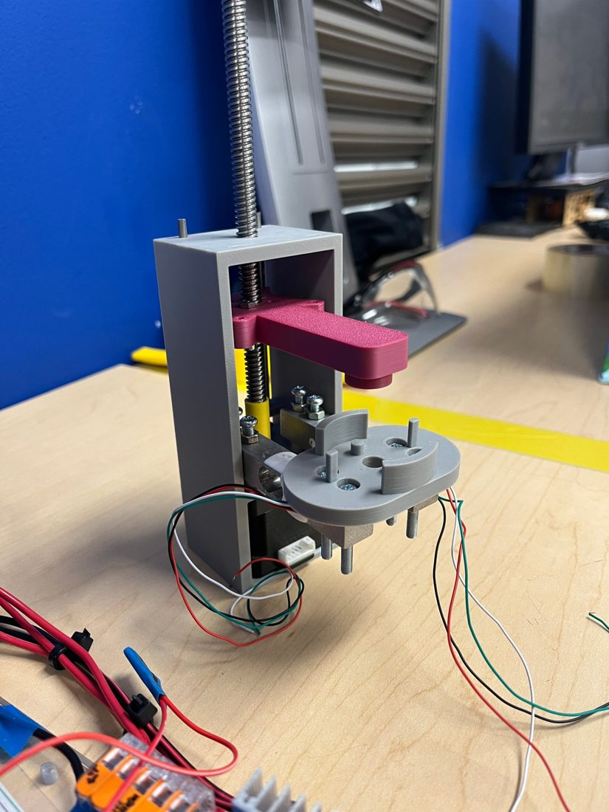

# Banco FSR · caracterización de un FSR402 dentro de silicona

Segundo banco del proyecto, **independiente del banco del dedo y con su propio ESP32**. Una prensa vertical baja un punzón con un tornillo movido por un NEMA 17 y presiona una cúpula de silicona que tiene un **FSR402** adentro. Dos **celdas de carga de 10 kg** (con un **HX711** cada una) miden la fuerza real. El ESP32 registra al mismo tiempo la posición del punzón, las dos fuerzas y el voltaje del FSR.

**▶ Página: https://luisponce15.github.io/banco-mano-robotica/fsr/**

| Pestaña | Qué tiene |
|---|---|
| **Ensayo** | Prensa animada y gráficas en vivo. Funciona con el **banco virtual** (simulación) o con el **ESP32 real por USB** (Chrome o Edge). Graba y exporta CSV. |
| **Análisis** | Curva del FSR contra la fuerza, ajuste (potencia y conductancia lineal), histéresis y repetibilidad. Abre CSV de ensayos reales. |
| **Conexiones** | Esquemático interactivo, pines, lista de cables y colores de las celdas. |
| **Montaje** | Cómo montar las celdas, la cúpula y el punzón, y la lista de chequeo antes de energizar. |
| **Modelo** | Parámetros del banco virtual y las ecuaciones que usa. |
| **Código** | Firmware, documentación y scripts de este banco. |

## Componentes

| Cant. | Componente | Uso |
|---|---|---|
| 1 | ESP32 DevKit V1 (**otro**, no el del dedo) | Control y adquisición, alimentado por USB desde el computador |
| 1 | NEMA 17 **17HS4401S** (1,7 A, 0,42 N·m) | Mueve el tornillo del punzón |
| 1 | Driver **A4988** con disipador | 1/16 de paso |
| 2 | Celda de carga tipo barra **10 kg** | Fuerza real sobre la cúpula |
| 2 | Módulo **HX711** | Amplificador y ADC de 24 bits de cada celda |
| 1 | **FSR402** dentro de la silicona | El sensor a caracterizar |
| 1 | Resistencia **10 kΩ** (o la que elijas con la simulación) | Divisor de voltaje del FSR |
| 1 | Condensador 100 nF (opcional) | Filtro en la entrada del ADC |
| 1 | Electrolítico **100 µF 25–35 V** | En VMOT del A4988 |
| 1 | Adaptador **12 V ≥ 2 A** | Potencia del motor |

## Pines del ESP32

| GPIO | Va a |
|---|---|
| 25 / 26 / 27 | A4988 STEP / DIR / EN |
| 16 / 17 | HX711 de la celda 1: DT / SCK |
| 18 / 19 | HX711 de la celda 2: DT / SCK |
| 34 | Nodo del divisor del FSR (ADC1) |
| 3V3 | A4988 VDD, MS1–MS3, RST+SLP · VCC de los dos HX711 · FSR |
| GND | Común con el GND del adaptador de 12 V |

Detalles en [`hardware/conexiones.md`](hardware/conexiones.md), [`hardware/montaje.md`](hardware/montaje.md) y [`hardware/calibracion.md`](hardware/calibracion.md).

## Flujo de un ensayo

1. Sube `firmware/fsr_ensayo/fsr_ensayo.ino` con el paquete **esp32 3.x** y la librería **FastAccelStepper** (gin66).
2. Abre la página, pestaña **Ensayo**, fuente **ESP32 por USB**, y conecta.
3. `t` tara · `c1 500` y `c2 500` calibran con una masa conocida (una sola vez; queda guardado).
4. `e` habilita el motor · `h` busca el contacto con la silicona (z = 0).
5. `r 3 0.5 2 3` corre 3 ciclos hasta 3 mm de profundidad a 0,5 mm/s con pausas de 2 s.
6. **Grabar** antes del ensayo y **Guardar CSV** al terminar. La pestaña **Análisis** saca la curva del FSR.

Sin navegador compatible: `python3 analisis/registrar_serial.py /dev/cu.usbserial-0001 ensayo.csv` guarda los datos y `python3 analisis/analizar_ensayo.py ensayo.csv` hace el análisis.
